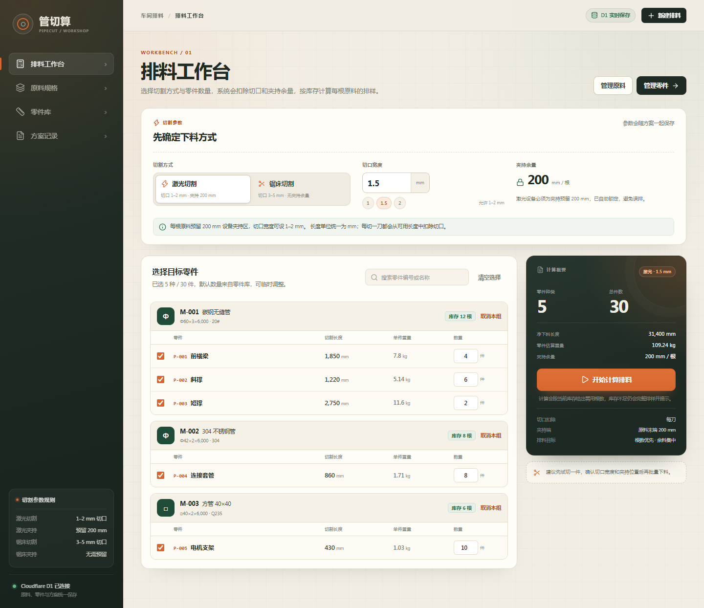
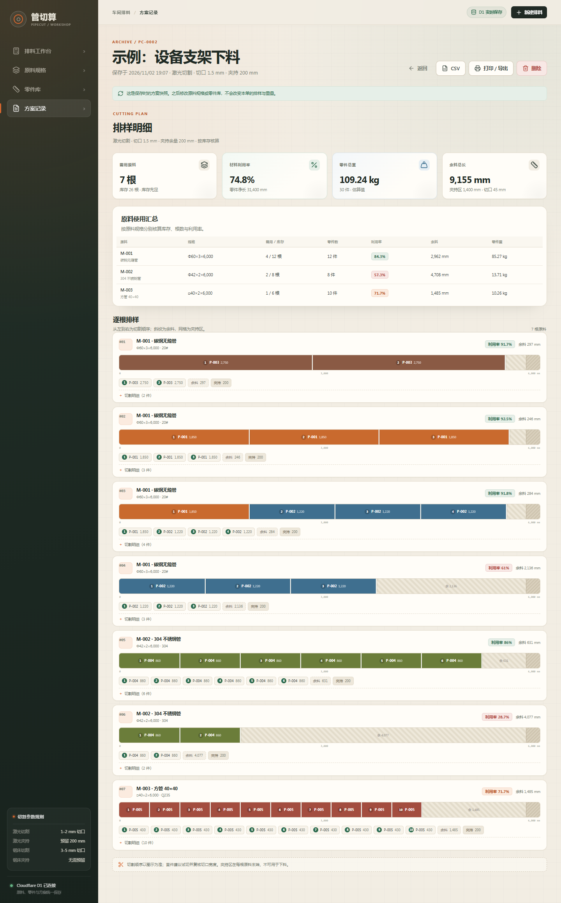

# 管切算 · PipeCut

面向车间的一维管材切割排料工具。前端是 React 单页应用，后端是一个 Cloudflare Worker，原料、零件和排料方案保存在 Cloudflare D1。一个 Worker 同时提供页面与 `/api`，部署后只需要一个网址。

## 线上地址

**<https://cut.fs-dm.com>**

当前部署已绑定到 Cloudflare 自定义域名 `cut.fs-dm.com`。`workers.dev` 在部分网络（尤其是国内）会被 DNS 污染，因此本项目默认关闭 `workers.dev`，只走自定义域名。





## 已实现的功能

- **原料规格管理**：圆管、方管、矩形管；外径/边长/宽高、壁厚、原料长度、材质牌号、密度、库存根数。
- **零件库**：零件绑定原料规格，设置切割长度、默认数量和备注；自动估算单件重量。
- **排料工作台**：
  - 激光切割：切口宽度限制 1–2 mm，每根原料自动预留 **200 mm** 夹持区，且不可修改。
  - 锯床切割：切口宽度限制 3–5 mm，**不预留**夹持余量。
  - 逐刀扣除切口；按库存计算需用根数，库存不足时仍给出完整排样并明确提示缺料数量。
  - 超长零件、已删除规格等情况会单独列出，不会静默丢失。
- **方案快照**：保存当时的切割参数、零件清单和完整排样，之后修改原料或零件不会影响已保存的加工单。
- **导出**：
  - 原料规格 CSV。
  - 零件清单 CSV。
  - 方案下料明细 CSV。
  - A4 加工单打印 / 浏览器“另存为 PDF”。
  - 加工单 PNG（适合发到车间群）。

  [查看示例加工单 PDF](docs/sample-plan.pdf)
- **响应式界面**：桌面端左侧导航，移动端顶部横向导航；加工单单独排版。
- **示例数据**：空库时可一键载入 3 种原料、5 种零件，直接体验。

## 技术栈

| 层 | 技术 |
| --- | --- |
| 前端 | React 19、TypeScript、Vite、React Router |
| 样式 | 原生 CSS（工业纸张风格，无外部字体依赖） |
| 后端 | Cloudflare Workers、Hono |
| 数据库 | Cloudflare D1（SQLite） |
| 校验 | Zod（前后端共用 schema） |
| 导出 | 浏览器打印、`html-to-image` |
| 测试 | Vitest |

## 本地运行

要求 Node.js 20+。首次运行：

```bash
npm install
npm run db:migrate
npm run build
npm run preview
```

打开 <http://127.0.0.1:8787>。第一次进入可点击“载入示例数据”。

开发模式（两个终端）：

```bash
# 终端 1：Worker + 本地 D1
npm run dev:api

# 终端 2：Vite 前端，/api 自动代理到 8787
npm run dev
```

Vite 地址为 <http://127.0.0.1:5173>。`dev:api` 使用 `dist` 里的静态资源，所以首次开发前也要先执行一次 `npm run build`。

### 常用脚本

| 命令 | 说明 |
| --- | --- |
| `npm run dev` | Vite 前端开发服务器 |
| `npm run dev:api` | Wrangler 本地 Worker，端口 8787 |
| `npm run build` | 类型检查 + 生产构建 |
| `npm run preview` | 用 Wrangler 预览生产构建 |
| `npm run test` | 排料算法单元测试 |
| `npm run typecheck` | 前端、Worker、配置文件类型检查 |
| `npm run db:migrate` | 应用本地 D1 迁移 |
| `npm run db:migrate:remote` | 应用远程 D1 迁移 |
| `npm run deploy` | 构建并部署到 Cloudflare |

## 部署到 Cloudflare Workers

当前账号已经创建并绑定：

- Worker：`pipecut`
- D1：`pipecut-db`
- 自定义域名：`cut.fs-dm.com`

以下步骤用于复现部署或换一个 Cloudflare 账号：

1. 登录 Wrangler：

   ```bash
   npx wrangler login
   ```

2. 创建 D1 数据库：

   ```bash
   npx wrangler d1 create pipecut-db
   ```

3. 把命令输出的 `database_id` 写入 [`wrangler.jsonc`](wrangler.jsonc)。

4. 初始化远程表结构：

   ```bash
   npm run db:migrate:remote
   ```

5. 构建并部署：

   ```bash
   npm run deploy
   ```

`wrangler.jsonc` 中的 `routes` 已配置 `cut.fs-dm.com`。如果要换域名，修改 `pattern` 后重新部署；Cloudflare 会自动创建 DNS 记录并签发证书。

> 本项目按“内部工具”设计，**没有登录和权限系统**。任何拿到网址的人都能查看和修改数据。如果部署到公网，建议在 Cloudflare 控制台给域名加上 **Cloudflare Access**，或改成带共享口令的版本。

## GitHub 自动构建与部署

GitHub 可以完全替代本地构建。仓库里已经包含：

```text
.github/workflows/deploy.yml
```

工作流在每次推送到 `main` 时执行：

1. `npm ci`
2. 类型检查 + 单元测试
3. `npm run build`
4. 对远程 D1 执行迁移
5. `wrangler deploy`

### 第一次配置

1. 在 GitHub 创建一个空仓库，把 `pipecut` 目录内容推送到 `main`（不要提交 `node_modules`、`dist`、`.wrangler`，这些已在 `.gitignore` 中）。
2. 在 Cloudflare 创建 API Token：
   - Cloudflare Dashboard → My Profile → API Tokens → Create Token
   - 使用 **Edit Cloudflare Workers** 模板
   - 额外确认包含 D1 Edit、Workers Scripts Edit、Workers Routes Edit、Zone Read
3. 在 GitHub 仓库 → Settings → Secrets and variables → Actions 添加：
   - `CLOUDFLARE_API_TOKEN`
   - `CLOUDFLARE_ACCOUNT_ID`（当前账号为 `50e5e10e9588d8027920cb4a25a58ab7`）
4. 推送代码，或在 Actions 页面手动运行 `Deploy to Cloudflare Workers`。

之后更新功能只需要提交代码，不需要本地 Node、Wrangler 或 Cloudflare 登录。

> 如果 Secrets 还没配置，工作流仍会完成安装、类型检查、测试和构建，但会跳过部署并输出一条提示；配置好 Secrets 后，下一次运行就会自动发布。


## 计算口径

### 一维排料

只按切割长度排料，不计算坡口、角度、二维轮廓或套料。每根原料：

```text
可用长度 = 原料长度 - 夹持余量
每件占用 = 零件长度 + 切口宽度
n 件合计 = Σ零件长度 + n × 切口宽度
```

- 激光：`夹持余量 = 200 mm`，固定值；每根原料末端预留，不参与下料。
- 锯床：`夹持余量 = 0 mm`。
- 最后一刀也计算切口宽度，结果偏保守，便于现场留出误差。
- 余料为 `可用长度 - 已占用长度`，单独统计，不自动回库。
- 原料利用率 = `零件净长合计 / 原料总长合计`，不把切口和夹持区算作有效利用。
- 库存不足时仍会生成完整排样，同时提示“需要 X 根 / 库存 Y 根 / 缺 Z 根”。

### 排料策略

1. 按原料规格分组，同组内把零件按长度从大到小排序。
2. 使用 Best-Fit Decreasing 放入最合适的原料。
3. 再做一次“尝试清空最空的一根、把零件重新分配”的改进，优先减少原料根数。
4. 在根数相同的情况下，让余料尽量集中，方便整段回收。

这是适合车间使用的启发式算法，不保证数学意义上的全局最优；如果零件组合特别复杂，可以人工调整数量后重新计算。

### 重量估算

单位：长度 mm，密度 g/cm³，结果 kg。

```text
圆管：  W = π × t × (D - t) × L × ρ / 1,000,000
方管：  W = 4 × t × (a - t) × L × ρ / 1,000,000
矩形管：W = 2 × t × (w + h - 2t) × L × ρ / 1,000,000
```

其中 `t` 为壁厚，`D` 为外径，`a` 为方管边长，`w/h` 为矩形管宽高，`L` 为长度，`ρ` 为密度。结果为估算值，实际以过磅为准。

## 数据模型

| 表 | 用途 |
| --- | --- |
| `materials` | 原料规格与库存 |
| `parts` | 零件，外键关联 `materials` |
| `plans` | 方案摘要 + 完整结果 JSON 快照 |

方案保存时会把计算结果整体写入 `plans.payload`；因此原料或零件后续被修改、删除，历史加工单仍然可以打开、打印和导出。删除仍有零件的原料规格会被拒绝，避免产生孤立零件。

### 备份

```bash
npx wrangler d1 export pipecut-db --remote --output=pipecut-backup.sql
```

## API 摘要

| 方法 | 路径 | 说明 |
| --- | --- | --- |
| `GET` | `/api/health` | 健康检查 + D1 连通性 |
| `GET/POST` | `/api/materials` | 原料列表 / 新增 |
| `PUT/DELETE` | `/api/materials/:id` | 修改 / 删除（有零件时拒绝） |
| `GET/POST` | `/api/parts` | 零件列表 / 新增 |
| `PUT/DELETE` | `/api/parts/:id` | 修改 / 删除 |
| `POST` | `/api/plans/calculate` | 按当前库存计算排料，不保存 |
| `GET/POST` | `/api/plans` | 方案列表 / 保存方案 |
| `GET/DELETE` | `/api/plans/:id` | 读取 / 删除方案 |
| `POST` | `/api/demo` | 空库时载入示例数据 |

## 目录结构

```text
.
├── migrations/            D1 初始化 SQL
├── shared/
│   ├── optimizer.ts       排料算法
│   ├── format.ts          规格、重量、日期格式化
│   ├── types.ts           前后端共享类型
│   └── validation.ts      Zod 校验
├── worker/
│   └── index.ts           Hono API + D1 访问
├── src/
│   ├── components/        布局、表单、排样图、加工单
│   ├── pages/             排料、原料、零件、方案页面
│   ├── context/           数据与 Toast
│   ├── lib/               API、CSV、下载
│   └── styles.css
├── tests/                 算法单元测试
├── wrangler.jsonc         Worker + D1 + 静态资源配置
└── vite.config.ts
```

## 当前边界

- 单次排料最多 **1500 件**；方案快照超过约 800 KB 时会提示分批保存（避免超过 D1 单条记录限制）。
- 不处理切割角度、坡口、相贯线、二维套料；这些需要更复杂的几何模型。
- 不自动把余料转为新原料；余料只在方案中统计。
- 保存方案不会自动扣减原料库存；排料只按当前库存检查，实际下料后需要手工调整库存或再做一次库存扣减功能。
- PDF 通过浏览器打印生成，推荐 Chrome / Edge，A4 纵向、默认边距。
- PNG 是整张加工单长图；特别长的方案建议优先用 PDF。
- 没有登录。公网部署请配合 Cloudflare Access。

## 验证

```bash
npm run typecheck
npm test
npm run build
```

算法测试覆盖：激光 200 mm 夹持、锯床无夹持、逐刀切口、库存不足、超长零件、圆管/方管重量、排样分段和多规格分组。
